 

## Mexendo agora

Agentes e workflows de IA. Estou testando jeitos de colocar IA dentro de projetos de verdade: onde ela ajuda, onde atrapalha, o que vale automatizar e o que é melhor deixar na mão. Junto com isso, Power BI e KNIME pra dados e um pouco de redes de computadores.

## Coisas que fiz

- [chat-tcp-multiusuario](https://github.com/jonasssgabriel/chat-tcp-multiusuario): chat em Java com socket, pool de threads e protocolo JSON
- [aplicacao-tres-camadas-docker](https://github.com/jonasssgabriel/aplicacao-tres-camadas-docker): front no Nginx, API, Redis e proxy reverso, tudo em Docker com rede isolada
- [analise-vendas-knime](https://github.com/jonasssgabriel/analise-vendas-knime): análise de vendas no KNIME com Python
- [associacao-data-mining](https://github.com/jonasssgabriel/associacao-data-mining): regras de associação em mineração de dados
- [sort-lab](https://github.com/jonasssgabriel/sort-lab): compara algoritmos de ordenação em tipos diferentes de entrada
- [mapa-do-armazenamento](https://github.com/jonasssgabriel/mapa-do-armazenamento): scanner em Python que mostra pra onde foi o espaço do disco
- [MongoDB-Jonas-Lucas](https://github.com/jonasssgabriel/MongoDB-Jonas-Lucas): lista de tarefas com CRUD, tags e comentários, em Python e MongoDB Atlas
- [pdv-web](https://github.com/jonasssgabriel/pdv-web): PDV web com impressão térmica

## O que eu uso

Mais Java, TypeScript, PHP e Python. Pra tela, React com Tailwind e Vite, e Figma quando preciso desenhar antes. Pra API, Node com Express. Pra guardar dado, SQLite e MongoDB. Pra analisar, Power BI, KNIME, SQL e Pandas. Git pra tudo.

 

 

## Contato

jonassgabriel433@gmail.com
