<picture>
  <source media="(max-width: 600px) and (prefers-color-scheme: dark)" srcset="assets/hero-mobile-dark.svg">
  <source media="(max-width: 600px) and (prefers-color-scheme: light)" srcset="assets/hero-mobile-light.svg">
  <source media="(prefers-color-scheme: dark)" srcset="assets/hero-dark.svg">
  <source media="(prefers-color-scheme: light)" srcset="assets/hero-light.svg">
  
</picture>

<picture>
  <source media="(max-width: 600px) and (prefers-color-scheme: dark)" srcset="assets/sec-sobre-mobile-dark.svg">
  <source media="(max-width: 600px) and (prefers-color-scheme: light)" srcset="assets/sec-sobre-mobile-light.svg">
  <source media="(prefers-color-scheme: dark)" srcset="assets/sec-sobre-dark.svg">
  <source media="(prefers-color-scheme: light)" srcset="assets/sec-sobre-light.svg">
  
</picture>

Estudo Ciência da Computação no CEULP/ULBRA, em Palmas (TO), e desenvolvo software: aplicações web, aplicativos mobile, sistemas e projetos próprios. Hoje divido o tempo entre o **MedLocate**, um aplicativo para encontrar serviços de saúde na cidade, e o **SoluCode OS**, um sistema interno que coordena agentes de IA.

<picture>
  <source media="(max-width: 600px) and (prefers-color-scheme: dark)" srcset="assets/sec-projetos-mobile-dark.svg">
  <source media="(max-width: 600px) and (prefers-color-scheme: light)" srcset="assets/sec-projetos-mobile-light.svg">
  <source media="(prefers-color-scheme: dark)" srcset="assets/sec-projetos-dark.svg">
  <source media="(prefers-color-scheme: light)" srcset="assets/sec-projetos-light.svg">
  
</picture>

<picture>
  <source media="(max-width: 600px) and (prefers-color-scheme: dark)" srcset="assets/plate-medlocate-mobile-dark.svg">
  <source media="(max-width: 600px) and (prefers-color-scheme: light)" srcset="assets/plate-medlocate-mobile-light.svg">
  <source media="(prefers-color-scheme: dark)" srcset="assets/plate-medlocate-dark.svg">
  <source media="(prefers-color-scheme: light)" srcset="assets/plate-medlocate-light.svg">
  
</picture>

`React Native` `Expo` `Node.js` `PostgreSQL` `GitHub Actions`

Aplicativo para encontrar unidades de saúde e farmácias de Palmas (UBS, USF, UPA, hospitais e farmácias). Mostra no mapa o que está por perto, permite buscar por região, avaliar, favoritar e avisar quando um dado está incorreto. Projeto acadêmico em equipe, com API própria e integração contínua. O repositório é privado.

<picture>
  <source media="(max-width: 600px) and (prefers-color-scheme: dark)" srcset="assets/plate-solucode-mobile-dark.svg">
  <source media="(max-width: 600px) and (prefers-color-scheme: light)" srcset="assets/plate-solucode-mobile-light.svg">
  <source media="(prefers-color-scheme: dark)" srcset="assets/plate-solucode-dark.svg">
  <source media="(prefers-color-scheme: light)" srcset="assets/plate-solucode-light.svg">
  
</picture>

`TypeScript` `Claude Code` `Codex`

Sistema interno da SoluCode, hoje em fase de pesquisa e arquitetura: Command Center, base de conhecimento, documentação viva e coordenação de agentes de IA, com decisões registradas em formato ADR. O repositório é privado.

**Outros trabalhos**

- **RegEx Elite**: aplicação web didática sobre linguagens regulares e expressões regulares, feita em grupo para Linguagens Formais. [Código](https://github.com/jonasssgabriel/ConjuntosRegularesSystem) | [Demo](https://jonasssgabriel.github.io/ConjuntosRegularesSystem/)
- **PDV Web**: ponto de venda executado no navegador, com impressão térmica em papel de 80 mm e dados no LocalStorage. [Código](https://github.com/jonasssgabriel/pdv-web) | [Demo](https://jonasssgabriel.github.io/pdv-web/)
- **Aplicação em três camadas com Docker**: frontend em Nginx, API interna e Redis atrás de proxy reverso, com rede isolada. [Código](https://github.com/jonasssgabriel/aplicacao-tres-camadas-docker)
- **Chat TCP multiusuário**: cliente e servidor em Java com sockets, pool de threads e protocolo em JSON. [Código](https://github.com/jonasssgabriel/chat-tcp-multiusuario)
- **Classificador de roupas com CNN**: rede neural convolucional com TensorFlow e Keras e interface em Gradio, feita em dupla. [Código](https://github.com/Luckleal/reconhecimento-roupas-cnn)

<picture>
  <source media="(max-width: 600px) and (prefers-color-scheme: dark)" srcset="assets/sec-stack-mobile-dark.svg">
  <source media="(max-width: 600px) and (prefers-color-scheme: light)" srcset="assets/sec-stack-mobile-light.svg">
  <source media="(prefers-color-scheme: dark)" srcset="assets/sec-stack-dark.svg">
  <source media="(prefers-color-scheme: light)" srcset="assets/sec-stack-light.svg">
  
</picture>

- **Linguagens:** `TypeScript` `JavaScript` `Python` `Java` `PHP`
- **Web e mobile:** `React` `React Native` `Expo` `Vite` `HTML` `CSS`
- **Back-end e dados:** `Node.js` `PostgreSQL` `MongoDB` `Redis` `KNIME`
- **Infraestrutura:** `Docker` `Nginx` `GitHub Actions` `Git`
- **IA:** `Claude Code` `Codex` `TensorFlow` `Keras` `Gradio`

<picture>
  <source media="(max-width: 600px) and (prefers-color-scheme: dark)" srcset="assets/sec-atividade-mobile-dark.svg">
  <source media="(max-width: 600px) and (prefers-color-scheme: light)" srcset="assets/sec-atividade-mobile-light.svg">
  <source media="(prefers-color-scheme: dark)" srcset="assets/sec-atividade-dark.svg">
  <source media="(prefers-color-scheme: light)" srcset="assets/sec-atividade-light.svg">
  
</picture>

<picture>
  <source media="(prefers-color-scheme: dark)" srcset="https://raw.githubusercontent.com/jonasssgabriel/jonasssgabriel/output/pacman-contribution-graph-dark.svg?v=6">
  <source media="(prefers-color-scheme: light)" srcset="https://raw.githubusercontent.com/jonasssgabriel/jonasssgabriel/output/pacman-contribution-graph.svg?v=6">
  
</picture>

<picture>
  <source media="(max-width: 600px) and (prefers-color-scheme: dark)" srcset="assets/sec-contato-mobile-dark.svg">
  <source media="(max-width: 600px) and (prefers-color-scheme: light)" srcset="assets/sec-contato-mobile-light.svg">
  <source media="(prefers-color-scheme: dark)" srcset="assets/sec-contato-dark.svg">
  <source media="(prefers-color-scheme: light)" srcset="assets/sec-contato-light.svg">
  
</picture>

[jonassgabriel433@gmail.com](mailto:jonassgabriel433@gmail.com)

<picture>
  <source media="(max-width: 600px) and (prefers-color-scheme: dark)" srcset="assets/footer-mobile-dark.svg">
  <source media="(max-width: 600px) and (prefers-color-scheme: light)" srcset="assets/footer-mobile-light.svg">
  <source media="(prefers-color-scheme: dark)" srcset="assets/footer-dark.svg">
  <source media="(prefers-color-scheme: light)" srcset="assets/footer-light.svg">
  
</picture>
