 

Estudante de Ciência da Computação em Palmas, TO. 
Foco atual em IA e agentes, com interesse em experiência e design.

 

  

<b>Trocar de jogo</b>

 

 

## Stack

## Projetos

<b>Dados</b>

- [analise-vendas-knime](https://github.com/jonasssgabriel/analise-vendas-knime): análise de vendas com KNIME
- [associacao-data-mining](https://github.com/jonasssgabriel/associacao-data-mining): regras de associação em mineração de dados

<b>Redes e sistemas</b>

- [chat-tcp-multiusuario](https://github.com/jonasssgabriel/chat-tcp-multiusuario): chat TCP em Java
- [aplicacao-tres-camadas-docker](https://github.com/jonasssgabriel/aplicacao-tres-camadas-docker): Nginx, API e Redis com Docker
- [SPD-ColetorLogsUDP](https://github.com/jonasssgabriel/SPD-ColetorLogsUDP): coletor de logs via UDP em Java

<b>Aplicações</b>

- [pdv-web](https://github.com/jonasssgabriel/pdv-web): PDV web com impressão térmica
- [MongoDB-Jonas-Lucas](https://github.com/jonasssgabriel/MongoDB-Jonas-Lucas): lista de tarefas com Python e MongoDB
- [sort-lab](https://github.com/jonasssgabriel/sort-lab): comparação de algoritmos de ordenação
- [mapa-do-armazenamento](https://github.com/jonasssgabriel/mapa-do-armazenamento): scanner de disco em Python

