 

 

## Sobre

Estudante de Ciência da Computação em Palmas (TO). Já passei por front-end, back-end e UI/UX, mas hoje é com dados que eu mais gosto de trabalhar — principalmente **Power BI** e **KNIME**.

Gosto de fazer as duas pontas: montar a interface do dashboard **e** analisar os dados por trás pra tirar uma conclusão real, não só um gráfico bonito.

 

## Painel

Linguagens consideram apenas código (HTML/CSS ficam de fora). Snapshot de out/2026.

 

## Projetos

| | |
|---|---|
| 📊 [**analise-vendas-knime**](https://github.com/jonasssgabriel/analise-vendas-knime) | Análise de vendas com KNIME e Python |
| 🔗 [**associacao-data-mining**](https://github.com/jonasssgabriel/associacao-data-mining) | Mineração de regras de associação |
| 🐳 [**aplicacao-tres-camadas-docker**](https://github.com/jonasssgabriel/aplicacao-tres-camadas-docker) | Frontend Nginx, API, Redis, proxy reverso e rede isolada |
| 💬 [**chat-tcp-multiusuario**](https://github.com/jonasssgabriel/chat-tcp-multiusuario) | Chat TCP multiusuário em Java com ThreadPool e protocolo JSON |
| 🧮 [**sort-lab**](https://github.com/jonasssgabriel/sort-lab) | Laboratório para comparar algoritmos de ordenação |
| 🗂️ [**mapa-do-armazenamento**](https://github.com/jonasssgabriel/mapa-do-armazenamento) | Scanner de uso de disco em Python |

 

## Stack

 

